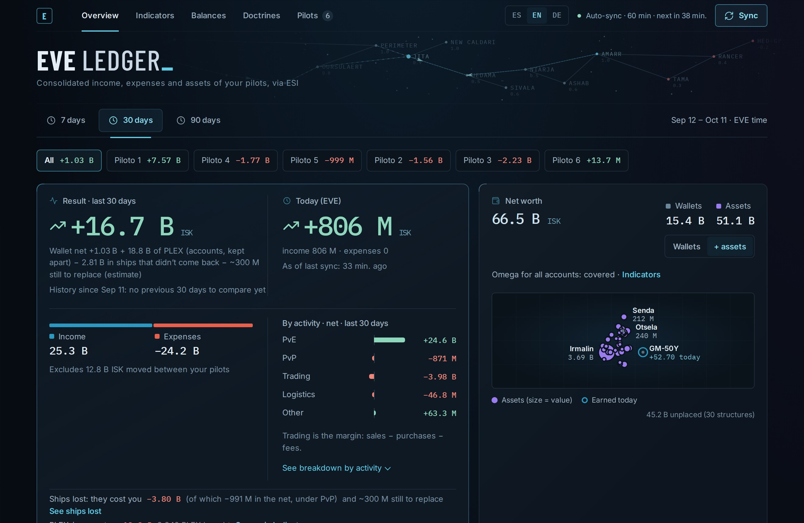
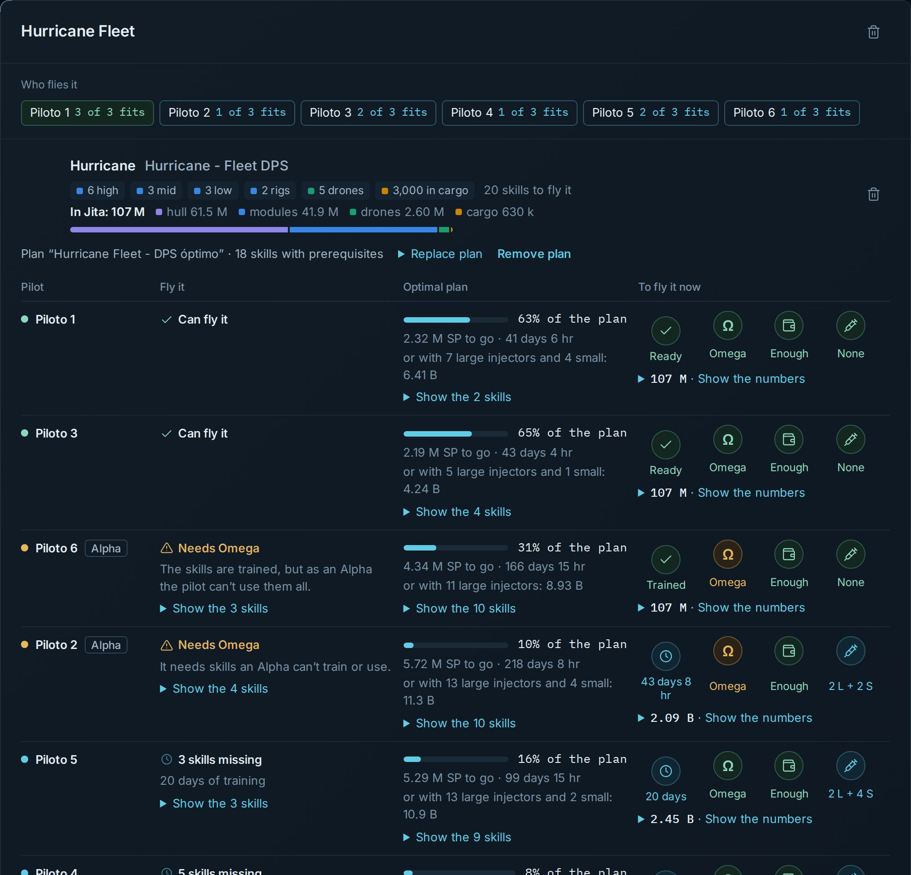

# EVE Ledger

**Are your characters making or losing ISK?** EVE Ledger is a free desktop app that pulls the wallets, assets, lost ships and skills of all your EVE Online characters from ESI and answers that at a glance. It runs entirely on your computer.

[Español](#español) · [Download](../../releases/latest) · Windows · macOS (Apple Silicon) · Linux · English / Español / Deutsch



## What it does

- **Net by activity.** Income and expenses for all your characters together or one at a time, split into PvE, PvP, trading, logistics and other. PLEX bought for your accounts is kept apart, so it doesn't sink your game result. Transfers between your own characters never count as income.
- **Lost ships, honestly.** A loss doesn't touch your wallet: you paid for the ship when you bought it. EVE Ledger tracks what it really cost you: the replacement your characters bought afterwards (hull, the same modules or equivalent ones, and cargo), the courier that moved it, and insurance. Anything you never replaced counts too.
- **Doctrines.** Paste a fit in EFT format and an EVEMon plan (`.emp`). You see:
  - who can fly the fit today;
  - what each character is missing and how long it takes to train;
  - whether it needs Omega;
  - what it costs at the lowest Jita sell price, skill injectors included, and whether your wallets cover it.
- **Indicators.**
  - Omega for all your accounts against your wallet balance, and your daily pace.
  - Ratting ISK per hour by character and by system.
  - Your lost ships measured in hours of ratting.
  - Market fees and taxes.
- **Balances.** Your numbers presented as books: a balance sheet, an income statement and a wallet reconciliation that adds up to the ISK.
- **Your history, kept.** ESI only serves about 30 days of wallet history, so EVE Ledger stores everything it syncs.
  - It runs in the system tray and can start when you sign in, syncing every hour.
  - It makes a daily backup that you can download and restore from **Pilots → Backups**.



## Privacy and security

- **Everything stays on your machine.** There is no server and no account; your data lives in a local SQLite database. The app only listens on `127.0.0.1` and refuses requests addressed to any other host name, so websites you visit can't reach it.
- **Read-only access.** The EVE login asks for these scopes, all read-only:
  - `esi-wallet.read_character_wallet.v1`
  - `esi-assets.read_assets.v1`
  - `esi-killmails.read_killmails.v1`
  - `esi-contracts.read_character_contracts.v1`
  - `esi-skills.read_skills.v1`
  - `esi-universe.read_structures.v1` (optional: shows the names of the citadels where you keep items or trade)

  You can revoke access at any time from your EVE account's third-party applications page.
- **Login without secrets.** The login uses EVE SSO with PKCE: there is no client secret to steal, and you don't have to register anything at developers.eveonline.com. Access and refresh tokens are stored encrypted (AES-GCM) with a key generated on your computer.
- **What goes over the network:**
  - calls to ESI;
  - character portraits and item icons from CCP's image server;
  - the update check against this repository's GitHub releases.

## Install

1. Download the installer for your system from [Releases](../../releases/latest):
   - **Windows:** `.exe` or `.msi`
   - **macOS** (Apple Silicon): `.dmg`
   - **Linux:** `.deb` or `.AppImage`
2. The installers aren't code-signed yet:
   - **Windows:** SmartScreen shows a warning; choose **More info → Run anyway**.
   - **macOS:** the first time, right-click the app and choose **Open**.
   - **Linux:** the tray icon needs AppIndicator. On plain GNOME, install the *AppIndicator and KStatusNotifierItem Support* extension.
3. On first run, a short setup asks for your preferences:
   - how many pilots you'll link;
   - how often to sync;
   - how many Omega accounts you keep;
   - whether to start with the system and keep running in the tray.
4. Go to **Pilots → Link pilot**. The EVE login opens in your browser; pick a character, and it shows up in the app. Repeat for each character.

The app updates itself: it downloads new versions in the background and asks whether to restart now or when you quit. The full guide, in Spanish, is in [apps/desktop/INSTALAR.md](apps/desktop/INSTALAR.md).

## Build from source

The repository has three parts:

| Path | What it is |
|---|---|
| `apps/api` | Bun + Elysia + Drizzle + SQLite: SSO, ESI sync, and every number the app shows |
| `apps/web` | Astro (SSR) dashboard |
| `apps/desktop` | Tauri 2 app that runs the API and the dashboard as local processes, with the setup wizard, tray and updater |

Requirements: [Bun](https://bun.sh) 1.3, and for the desktop app [Rust](https://rustup.rs) plus the [Tauri prerequisites](https://v2.tauri.app/start/prerequisites/) for your system.

**An EVE application.** Create one at <https://developers.eveonline.com/applications>:
- add the six scopes listed above;
- set the callback URL:
  - `http://localhost:3000/auth/callback` for the API in development;
  - `http://127.0.0.1:47300/auth/callback` for the desktop app.

Only the Client ID is used.

**API and dashboard, in development:**

```sh
cd apps/api
cp .env.example .env    # set EVE_CLIENT_ID and ENC_KEY (32 random bytes, base64)
bun install && bun run dev          # http://localhost:3000
cd ../web
bun install && bun run dev          # http://localhost:4321
bun test                            # in apps/api: SSO, reconciliation, doctrines, backups
bun run test:e2e                    # in apps/web: builds and runs the end-to-end tests (Playwright, demo data)
```

**Desktop app:**

```sh
cd apps/desktop
bun run prepare:server                                   # bundles the API, the dashboard and Bun as a sidecar
EVE_LEDGER_CLIENT_ID=your-client-id bun run tauri build  # → src-tauri/target/release/bundle/
```

GitHub Actions builds the Windows, macOS and Linux installers when a new version reaches `main`. See [apps/desktop/README.md](apps/desktop/README.md), in Spanish, for signing updates and releasing.

## Contributing

Bug reports and ideas are welcome in [Issues](../../issues). To report a bug that depends on your data, `bun run export:debug` (in `apps/api`) writes an anonymized export with no tokens and no character names, so it can be reproduced without sharing your database.

## License

[MIT](LICENSE) © 2026 Sirrohan Yassavi

## Legal

EVE Online and the EVE logo are the registered trademarks of CCP hf. All rights are reserved worldwide. All other trademarks are the property of their respective owners. EVE Online, the EVE logo, EVE and all associated logos and designs are the intellectual property of CCP hf. All artwork, screenshots, characters, vehicles, storylines, world facts or other recognizable features of the intellectual property relating to these trademarks are likewise the intellectual property of CCP hf. EVE Ledger is not affiliated with, endorsed or supported by CCP hf. CCP is in no way responsible for the content or functioning of this software, nor can it be liable for any damage arising from its use.

The figures in the screenshots are demo data.

---

## Español

EVE Ledger es una app de escritorio gratuita que consolida los wallets, el inventario, las naves perdidas y las skills de todos tus personajes de EVE Online, vía ESI, para responder de un vistazo a la pregunta «¿gano o pierdo ISK?». Corre solo en tu equipo: sin servidor ni cuenta, y con los tokens cifrados.

- **Descarga:** [Releases](../../releases/latest) (Windows, macOS con Apple Silicon y Linux).
- **Guía de instalación:** [apps/desktop/INSTALAR.md](apps/desktop/INSTALAR.md).
- **Compilar y publicar versiones:** [apps/desktop/README.md](apps/desktop/README.md).
- **Licencia:** [MIT](LICENSE) © 2026 Sirrohan Yassavi. EVE Online y sus marcas son de CCP hf.; este programa no está afiliado a CCP.
